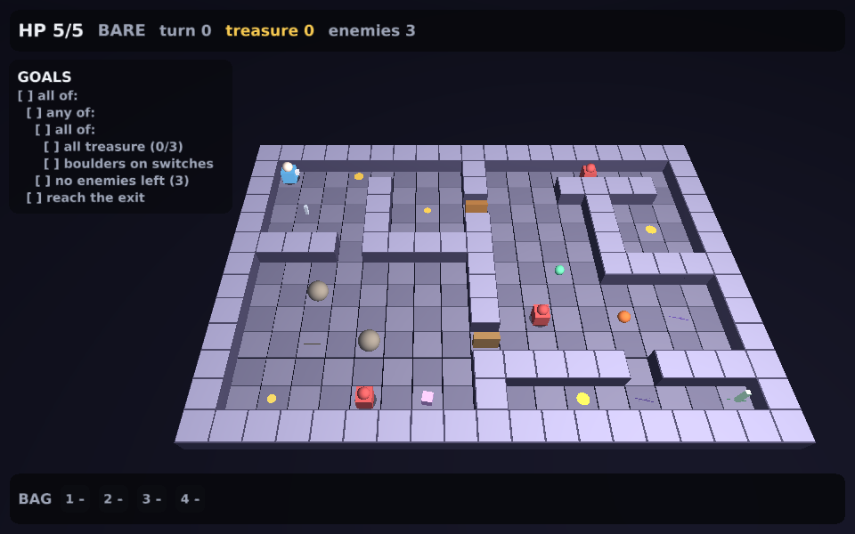

# Dungeon

The original turn-based Dungeon crawler in a standalone 3D QOS Portable window, with its pure game rules extracted alongside the renderer.

## Install and run

Needs QOS Portable 0.3.0 or later (`[sdk] version` in `qos.toml`), which adds `kind = "app"` projects to `qos build` and `qos run`. 0.3.0 is not released yet; until it is, put a staged SDK's `bin/` first on `PATH`. Tested on macOS ARM64.

```sh
brew install hyperswine/tap/fprisc hyperswine/tap/qos-portable  # fprisc provides sol
git clone https://github.com/hyperswine/dungeon.git
cd dungeon
qos build
qos run
```

Arrow keys or WASD move and face. Space interacts; 1–4 use inventory slots. R restarts, H shows help, P captures a frame and Q quits. The original built-in level, enemies, boulders, switches, doors/keys, portals and goal tree are retained.

## Test



```sh
sol project.sol test
```

The extracted upstream pure-rule suite covers movement, treasure, equipment, switches, keys/doors, potion duration, combat, enemy behavior, portals, death and composite win conditions. The Sol harness rejects any FAIL output and also launches the real 3D game, captures title/play/movement frames and verifies clean shutdown.

Builds can take several minutes for the larger applications. Build/test commands have explicit deadlines and return a failure when a child process fails. Generated binaries, caches, data, keys and raw logs are excluded from Git.

## Build tools

`qos.toml` (manifest 2, `kind = "app"`) describes the game. `qos build` compiles it with the SDK's own compiler, prelude and modules, links the SDK's private app-side platform files and the FP-RISC runtime that matches that compiler, checks a second link displaced by 256 MiB, and writes `build/dungeon.qa`. `qos run` creates `data/dungeon.disk` if needed and starts the SDK's `qosp-gl`. The project carries no copy of QOS's platform code and no build scripts; `sol project.sol build | run | test` only sequences those commands and the Sol test harness.

The SDK's `qos` command needs Python 3.11+, Clang and lld. macOS `sips` exports test PNGs; a shell and standard utilities provide FIFO and descriptor plumbing for the tests.

## Source and license

Extracted from [hyperswine/qos](https://github.com/hyperswine/qos/tree/7b5f9c122ada1fe429a865a0a48fdd59d2aa1e2f) at `7b5f9c122ada1fe429a865a0a48fdd59d2aa1e2f`. See [ORIGIN.md](ORIGIN.md) for the source map and local changes, and [LICENSE](LICENSE) for the upstream MIT license. No existing application data, private credentials, deployed host configuration or original source checkout is required.
